# 🚀 Grupo Casa Pellas · Suite de Inteligencia Artificial & Investigación de Operaciones

Plataforma unificada de **S&OP (Sales & Operations Planning)** y **Optimización Comercial Predictiva** desarrollada para el proceso de selección de **Senior AI Engineer & Operations Research Lead** en **Grupo Casa Pellas**.

* **🌐 Aplicación Web en Producción (Render):** [https://casa-pellas-ia.onrender.com](https://casa-pellas-ia.onrender.com)
* **📁 Repositorio / Código Fuente:** [https://github.com/Arley-Economist-Dev/prueba-ia-engineer](https://github.com/Arley-Economist-Dev/prueba-ia-engineer)
* **📊 Entregables Consolidados:** Carpeta `outputs/`

---

## ⚡ Guía de Reproducción Local en 3 Pasos

Para clonar y desplegar el entorno completo en tu estación de trabajo local:

### Paso 1: Clonar el repositorio y acceder al directorio
```bash
git clone https://github.com/Arley-Economist-Dev/prueba-ia-engineer.git
cd prueba-ia-engineer
```

### Paso 2: Crear entorno virtual e instalar dependencias
```bash
python -m venv .venv
# En Windows:
.venv\Scripts\activate
# En Linux / macOS:
# source .venv/bin/activate

pip install -r requirements.txt
```

### Paso 3: Lanzar la aplicación web interactiva
```bash
streamlit run app.py
```
La aplicación se abrirá automáticamente en tu navegador web en `http://localhost:8501`.

---

## 🧪 Validación Automatizada de Reproducibilidad (QA Suite)

Para ejecutar las sumas de control, auditar las reglas de negocio y regenerar los libros Excel en `outputs/`:

```bash
python test_pipeline.py
```

### Sumas de Control Validadas:
* **Caso 1 (Toyota S&OP):**
  * Estandarización de 52 variantes de texto hacia exactamente los **11 modelos oficiales** de `Economía por modelo`.
  * Normalización de 12 variantes de sucursales hacia las **7 sucursales autorizadas**.
  * Detección y neteo de las **9 Notas de Crédito (`NC-`)** por `-9 unidades` (5,213 brutas $\rightarrow$ **5,204 unidades netas reales**).
  * Aislamiento de ventas extraordinarias de flota fuera de ventana (`FAC-883958` por 60 Hilux y `FAC-884287` por 45 Yaris $\rightarrow$ 5,099 unidades de demanda regular).
  * Regla Crítica de Obsolescencia RAV4: **Pedido Octubre = 0 unidades**, permitiendo liquidar las 56 unidades en inventario/tránsito al 30 de abril de 2027 sin sobrestock ante la llegada de la nueva generación en mayo 2027.
* **Caso 2 (Capesa Seguros):**
  * Deduplicación exacta de las **151 pólizas idénticas** (25,351 brutas $\rightarrow$ **25,200 pólizas únicas**).
  * Identificación de las **577 pólizas contactadas post-vencimiento** en base bruta (**574** en base deduplicada) y verificación de la mediana operativa de contacto (**4 días** vs meta de **20 días**).
  * Cruce de las 78,058 llamadas de la bitácora: comprobación de las **9,808 llamadas (12.6%)** asignadas ineficientemente a *Domiciliado* y *Financiado*.
  * Validación de que la cartera *Manual* perdió **4,205 pólizas** por fuga con la competencia y **1,125 pólizas** por contacto tardío.

---

## 🏗️ Arquitectura de Datos y Modelos

```mermaid
flowchart TD
    subgraph S1["Caso 1: S&OP Vehículos Nuevos Toyota"]
        A1["Bases Sucias: Ventas, Leads, Tránsito, Inventario"] --> B1["Normalización 11 Modelos & 7 Sucursales\nNeteo de Notas de Crédito (-9 uds)"]
        B1 --> C1["Cálculo de Demanda Real = Ventas Netas + Leads CRM Stockout"]
        C1 --> D1["Proyección de Balance Dinámico al 31/Ene/2027"]
        D1 --> E1["Optimización Entera (Mínimos & Múltiplos)\nRegla de Obsolescencia RAV4 = 0 uds"]
        E1 --> F1["Asignación Hamilton / Restos Mayores:\nMezcla Versión y Color"]
    end

    subgraph S2["Caso 2: Orquestador Predictivo Capesa"]
        A2["Bases: Renovaciones, Bitácora, Equipo"] --> B2["Deduplicación 151 Pólizas & Limpieza de Teléfonos"]
        B2 --> C2["Diagnóstico Forense:\nQuiebre 01/12/2025 (7 a 5 Gestores)\nIneficiencia de Llamadas (12.6% en Auto)"]
        C2 --> D2["Modelo Predictivo P(Fuga)\nLogistic Regression & Gradient Boosting"]
        D2 --> E2["Índice de Priorización Comercial:\nValor en Riesgo = Prima x %Comisión x P(Fuga)"]
        E2 --> F2["Arquitectura de 3 Carriles:\nC1: Zero-Touch | C2: Bot T-25 | C3: Gestores Top Risk"]
    end
```



### 1. Caso 1: Pedidos Inteligentes Toyota (`src/caso1_engine.py`)
* **Balance Dinámico de Inventario:**
  $$\text{Inv}_{31\text{Ene27}} = \max\left(0, \text{Inv}_{30\text{Sep26}} + \text{Tránsito}_{\text{Oct26–Ene27}} - 4 \times \text{Demanda}_{\text{Mensual}}\right)$$
* **Demanda Objetivo S&OP:**
  $$\text{Demanda}_{\text{Objetivo}} = \text{Venta Mensual Ponderada} + (\alpha \times \text{Demanda Insatisfecha CRM})$$
  Donde $\alpha \in [0, 1]$ es el factor de captura de leads perdidos por falta de stock/color.
* **Optimización con Restricciones de Lote:**
  $$Q_m = 0 \quad \text{o bien} \quad Q_m = \max\left(\text{Mínimo}_m, \left\lceil \frac{\text{Necesidad Neta}_m}{\text{Múltiplo}_m} \right\rceil \times \text{Múltiplo}_m\right)$$
* **Regla Crítica RAV4 (Comunicado 15/09/2026):** Al corte existen 9 unidades en patio y 47 en tránsito (44 del pedido `PF-41141` de julio 2026). Con 56 unidades disponibles para 7 meses ($\sim 8\text{ uds/mes}$), pedir unidades adicionales crearía inventario obsoleto en mayo 2027 sin subsidio de fábrica. Se fuerza $Q_{\text{RAV4}} = 0$.
* **Desglose de Mezcla (Hamilton / Largest Remainder):** Distribuye de forma matemáticamente exacta las unidades del pedido según el vector de rotación histórica ajustado por demanda latente de versiones en el CRM.

### 2. Caso 2: Orquestador de Renovaciones Capesa (`src/caso2_engine.py`)
* **Diagnóstico Cuantitativo del Cuello de Botella:**
  * **Quiebre Estructural (01/12/2025):** La salida de los gestores `G06` y `G07` incrementó la carga de **292 a 381 pólizas/gestor/mes (+30.7%)**, colapsando la tasa de contacto a tiempo ($\ge 20\text{ días}$) de **37.1% a 8.2%** y reduciendo la renovación global de **62.0% a 50.6%** (y en Manual de **55.0% a 41.1%**).
  * **Asignación Subóptima:** Las 9,808 llamadas a formas automáticas representaron 12.6% de la capacidad humana en clientes con renovación natural $\ge 91\%$.
* **Modelado Predictivo de Fuga:**
  * Entrenamiento de pipeline con imputación, escalado robusto, codificación *One-Hot* y modelos probabilísticos interpretables (`LogisticRegression` con `ROC-AUC = 0.7101` y `HistGradientBoosting` con `ROC-AUC = 0.7509`).
  * Coeficientes causales demuestran que cada día de retraso en el contacto incrementa significativamente las probabilidades de fuga hacia corredores competidores.
* **Índice de Priorización por Valor en Riesgo:**
  $$\text{Valor en Riesgo (USD)} = \text{Prima Renovación} \times \%\text{Comisión} \times P(\text{Fuga})$$
  El **Top 30%** de la cartera manual concentra el **56.5% de todo el valor económico en riesgo**.
* **Arquitectura de 3 Carriles & Simulación de ROI:**
  * **Carril 1 (Zero-Touch Digital):** Libera 9,054 llamadas humanas al año y rescata **+\$21,368 USD/año** mediante alertas automáticas de cobro a *Domiciliado* y *Financiado*.
  * **Carril 2 (Agente IA Pre-Contacto T-25):** Contacta al 100% de la cartera manual a $T-25$ días por WhatsApp y Voz IA, resolviendo el desfase temporal y recuperando **+\$488,529 USD/año** en comisiones.
  * **Carril 3 (Bandeja Gestores Humanos Priorizada T-20):** Los 5 gestores negocian proactivamente las pólizas de mayor valor en riesgo utilizando el **Copiloto IA** (con cotizaciones alternativas multi-aseguradora), sumando **+\$67,485 USD/año** adicionales.
  * **Impacto Consolidado:** **+\$577,382 USD/año en comisiones rescatadas** y **+15.9 pp en tasa de retención global** (de 53.4% a 69.3%), operando los 5 gestores al 58% de su capacidad.

---

## 📑 Entregables de Salida (`outputs/`)

1. **`outputs/Pedido_Recomendado_Octubre_2026.xlsx`**:
   * `Resumen_Modelos`: Tabla maestra consolidada por modelo con inventario actual, tránsito, demanda proyectada, necesidad neta y pedido final ajustado a múltiplos.
   * `Proyeccion_Mensual`: Serie proyectada mes a mes (Sep 2026 a Abr 2027) de inventario de cierre, arribos y demanda.
   * `Mezcla_Version_Color`: Distribución exacta de unidades por versión y color.
   * `Analisis_Financiero`: Desglose de inversión de capital (\$13.34M USD), margen proyectado (\$1.65M USD) y costo financiero mensual de plan piso (\$120K USD/mes).
2. **`outputs/Bandeja_Priorizada_Capesa.xlsx`**:
   * `Diagnostico_Operativo`: Matriz de volumen de llamadas, pólizas y tasas de retención por forma de pago.
   * `Cartera_Priorizada`: Pólizas manuales clasificadas por gestor (`G01` a `G05`) ordenadas descendentemente por `Valor_En_Riesgo_USD`.
   * `Simulacion_ROI`: Desglose cuantitativo del impacto anual por carril de atención.

---

## 📜 Declaración del uso de Herramientas de IA y Protocolos de Validación Humana

### 1. Herramientas de Inteligencia Artificial Utilizadas
Durante el desarrollo de esta prueba técnica se utilizaron modelos de lenguaje de última generación (**Gemini 4 Argon** y **Gemini 3.8 Flash** en entorno Antigravity Pair-Programming) como asistentes avanzados de ingeniería para:
* Generación ágil de estructuras de código modular y plantillas de diseño visual en Streamlit.
* Aceleración de consultas exploratorias sobre los esquemas de datos en los archivos Excel.
* Redacción preliminar de guiones conversacionales para el Copiloto IA de retención.

### 2. Protocolos de Validación Humana y Auditoría Determinística
Ningún cálculo de negocio ni decisión metodológica fue delegada a respuestas directas o cajas negras de modelos de lenguaje sin estricta verificación empírica:
1. **Auditoría de Integridad de Datos:** Todas las transformaciones (normalización de cadenas con expresiones regulares, detección de Notas de Crédito y deduplicación de pólizas) fueron verificadas fila a fila mediante scripts determinísticos en Python (`pandas`/`numpy`).
2. **Validación de Reglas de Negocio:** Se contrastaron los comunicados oficiales (fechas de pedidos, restricciones de lote mínimo/múltiplo y advertencia de fin de ciclo de vida de RAV4) directamente contra la base de datos de pedidos y embarques en tránsito.
3. **Validación Cruzada de Modelos de Machine Learning:** Los modelos de estimación de probabilidad de fuga $P(\text{Fuga})$ se validaron mediante validación cruzada estratificada de 5 particiones (`StratifiedKFold(n_splits=5)`), evaluando métricas objetivas de discriminación (`ROC-AUC`) y calibración (`Brier Score Loss`), descartando sobreajuste (*overfitting*).
4. **Pruebas Automatizadas de Regresión:** La suite `test_pipeline.py` implementa aserciones estrictas (`assert`) que garantizan que el código es 100% reproducible y que cualquier alteración en los supuestos de negocio es detectada inmediatamente.

